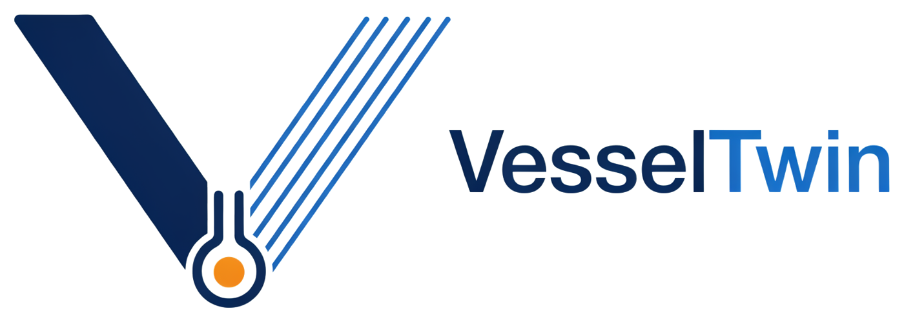
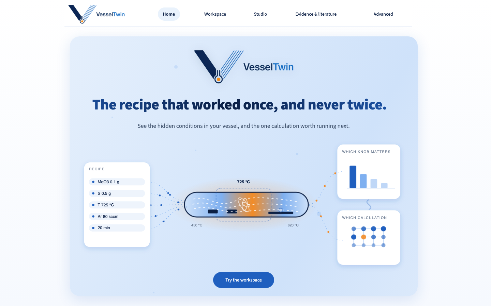
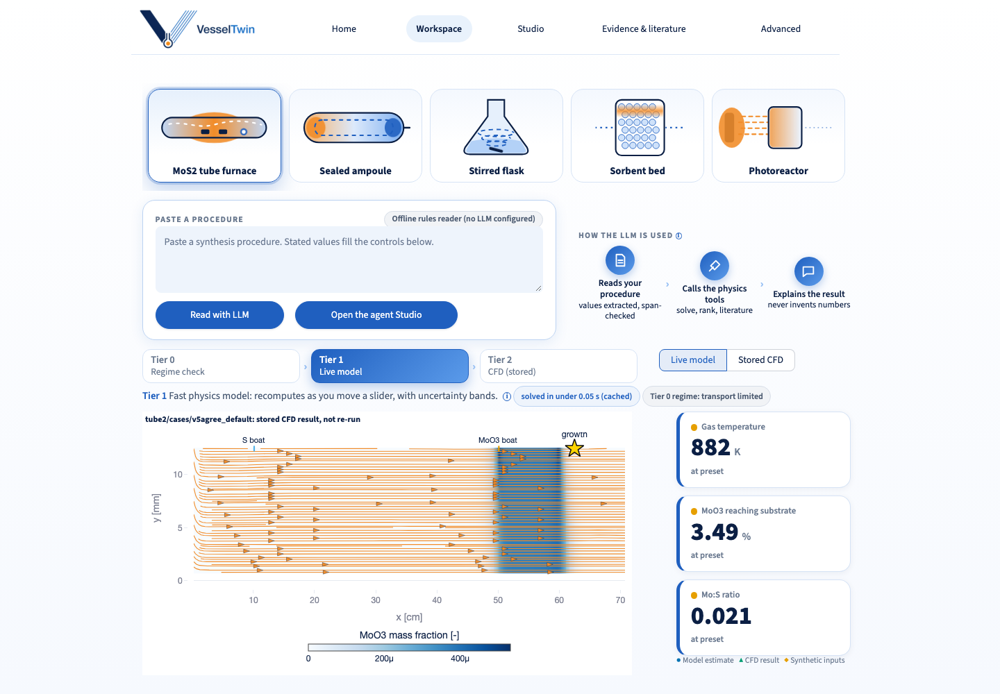
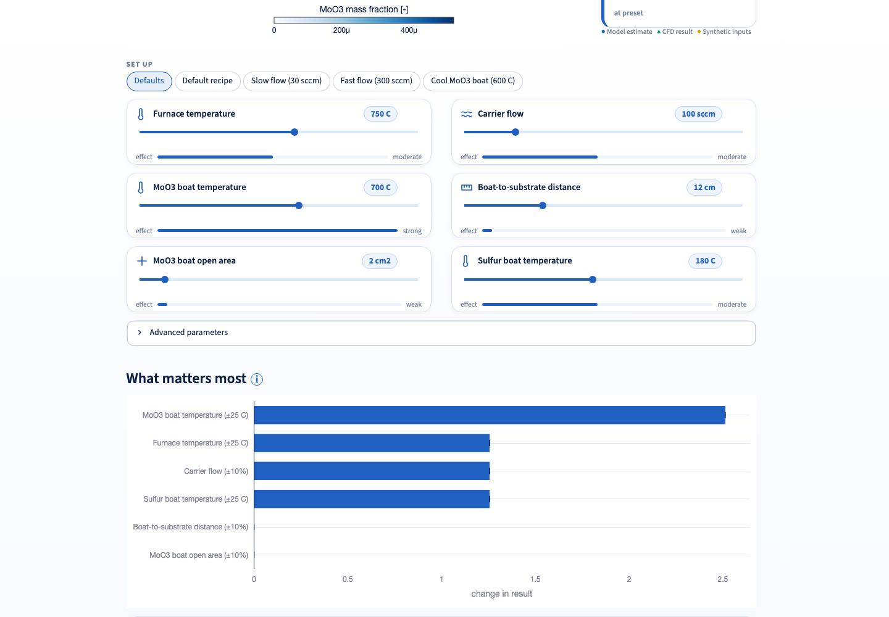
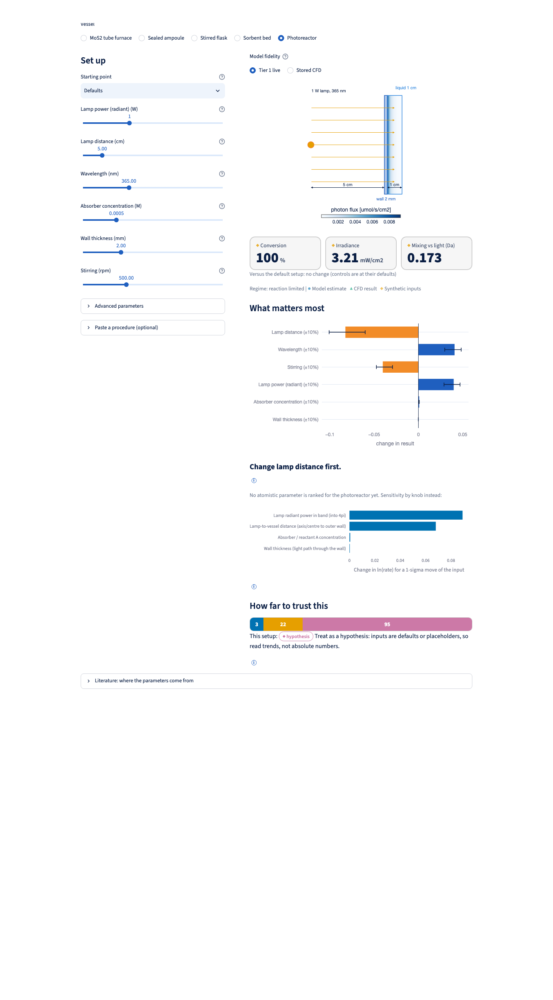
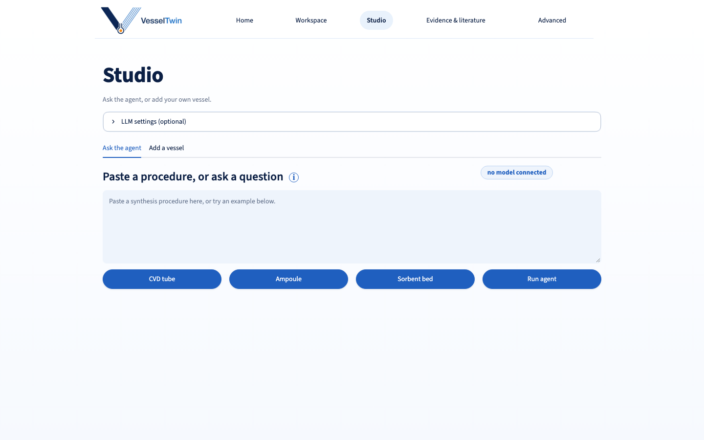
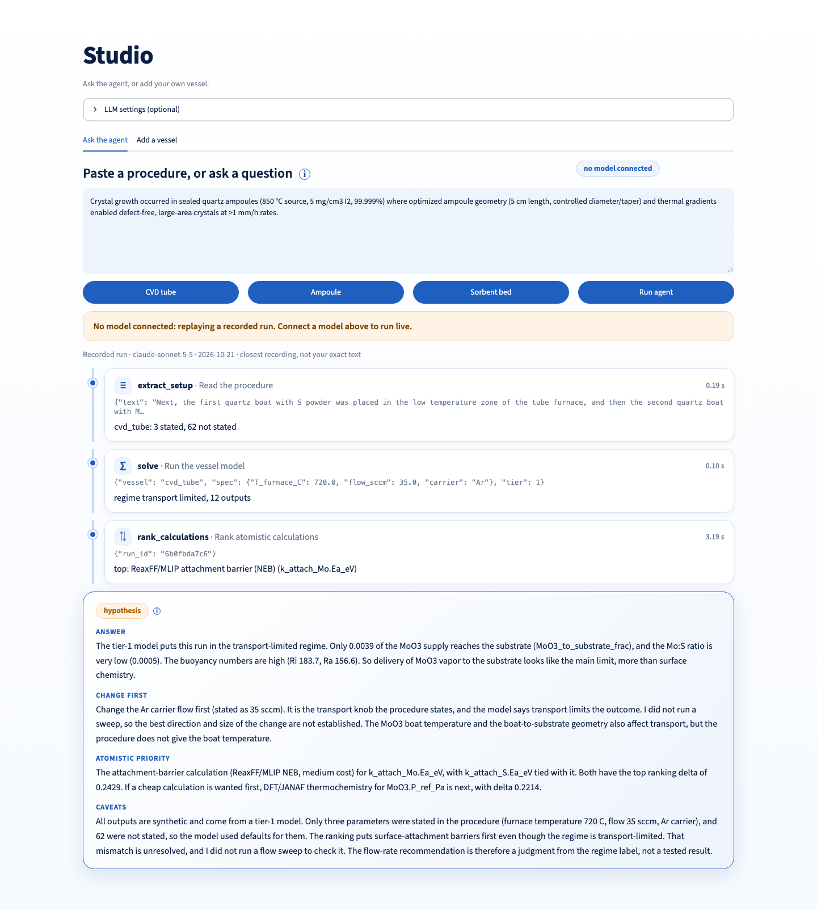
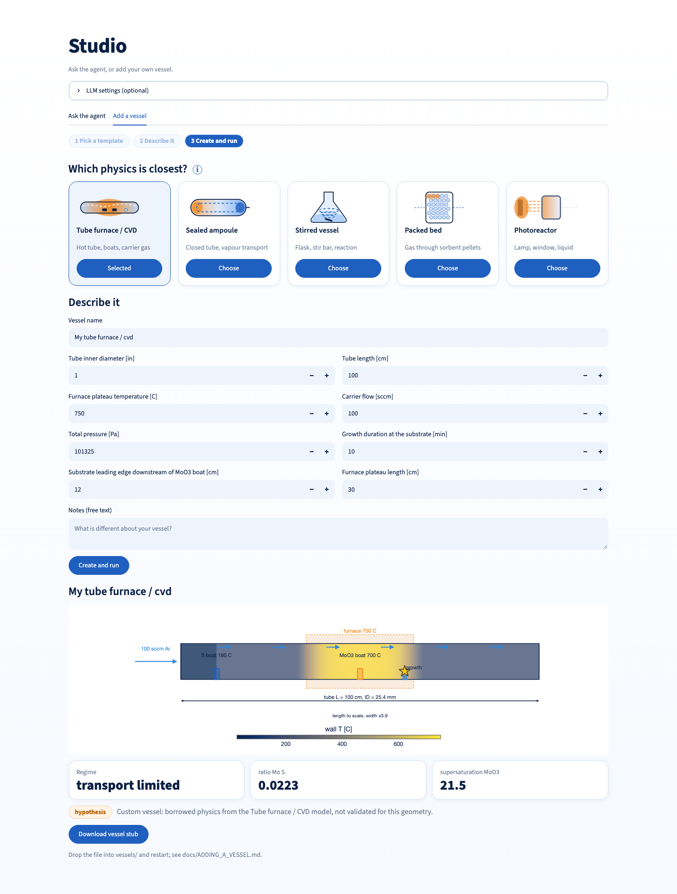
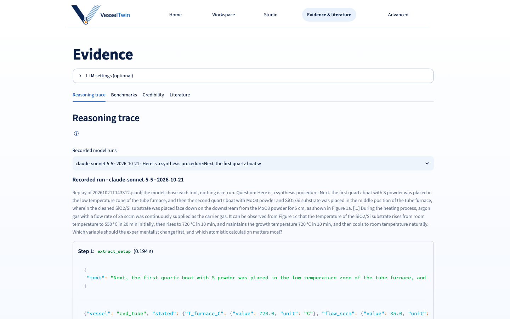
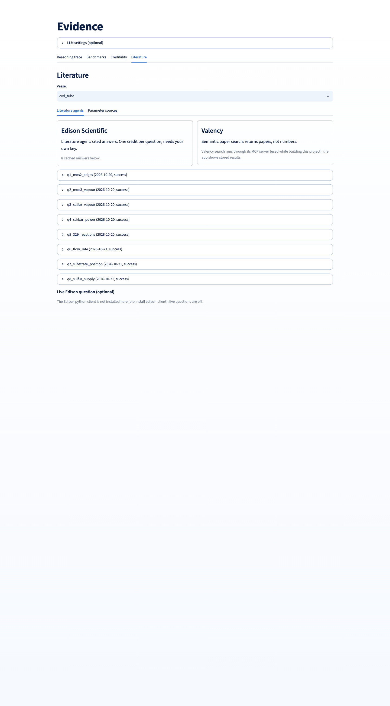

<p align="center">
  
</p>

<h3 align="center">The recipe that worked once, and never twice.<br>VesselTwin shows the hidden conditions in your vessel, and the one calculation worth running next.</h3>

<p align="center">
  <a href="#the-pain">The pain</a> ·
  <a href="#what-vesseltwin-does">What it does</a> ·
  <a href="#a-tour">Tour</a> ·
  <a href="#what-we-tested-including-what-failed">What we tested</a> ·
  <a href="#run-it">Run it</a> ·
  <a href="#add-your-own-vessel">Add a vessel</a>
</p>

**Live app: https://vesseltwin.streamlit.app**

> **The flagship MoS2 model fails our own benchmark, and the tool says so. That is the point.**
>
> **Status: research prototype.** Built for the OSI Hackathon 2026. It is a framework and verification harness for vessel-scale models. It is **not** a validated predictor of growth outcomes, and we say so everywhere in the product.
> **Provenance.** Development began on Oct 18, 2026 in a private repository (archived as `VesselTwin-dev-history`); the hackathon period began Oct 21, 2026. This repository is a clean snapshot of the final code.



## The pain

A paper reports a recipe. You repeat it, and the outcome changes. Nobody can see why, because between the chemistry and the result sits the **vessel**, and the vessel hides the variables that decide the outcome.

**If you run experiments,** you tune furnace temperature, flow and boat position by trial and error. You cannot see the local gas temperature at the substrate, where the vapour went before it got there, or how much light actually reached your sample. A change in tube diameter, lamp distance or stir rate quietly changes all of it.

**If you run atomistic simulations,** you can compute almost anything, but you do not know which calculation, under which local conditions, would actually change the experimental outcome. The conditions in a paper's methods section are not the conditions at the growing surface.

Each side holds half of the problem. The vessel is the missing link, and nobody models it in a form either side can use.

## What VesselTwin does

1. **Reads a procedure** as plain text and extracts the setup. Every value is tagged *stated*, *default* or *missing*, and every stated value is checked against the sentence it came from. The language model never produces a physical number.
2. **Models the vessel** at three levels: an instant regime call (Tier 0), fast reduced-order physics with Monte Carlo uncertainty bands (Tier 1, live), and OpenFOAM CFD (Tier 2, stored runs on the hosted site).
3. **Tells each person what to do next.** The experimentalist sees the knobs ranked by how much they move the result. The simulation scientist gets a ranked list of atomistic calculations whose outcome would change the prediction most.
4. **Labels every claim** *benchmarked*, *uncertain* or *hypothesis*. A label is capped by its weakest evidence and is never upgraded.

**Five vessels share one core:** MoS2 CVD tube furnace, sealed ampoule, stirred flask, sorbent bed, and photoreactor. A new vessel is one file.

## A tour

### Workspace: pick a vessel, move the knobs, see the physics

Five clickable vessel cards. A live vessel figure, big-number tiles with units and a status dot (model, CFD or synthetic), knobs with effect bars that show how strongly each one moves the headline result, and a strip that explains the tiers.





The same workspace for a photoreactor (lamp power, distance, wavelength, wall thickness):



### Studio: where the language model fits

The model reads your procedure, calls the physics and literature tools, and explains the result. It never invents a number. Connect any provider with your own key, or run fully offline; with no model connected, the Studio replays a recorded run.





You can also add your own vessel from a physics template. It runs with borrowed physics and is always labelled *hypothesis*; a stub file lets a developer make it real.



### Evidence and literature: why you can trust it, or not

The reasoning trace of each run, the benchmark table (including the failures), the credibility harness, and the literature agents. Edison Scientific and Valency supplied sourced parameters; cached answers are shown with their question, date and verification status.





## How the pieces fit

```
procedure text --llm/extract (offline rules | any LLM provider)--> SetupSpec (stated / default / missing, span-checked)
                                                        |
          presets/<vessel>__<set>.json  --->  core.api.solve  <--- Closure (atomistic value -> vessel parameter)
                                                        |
        vessels/*  (auto-discovered)   Tier 0: regime  ->  Tier 1: reduced model + Monte Carlo
                                                        |                         |
                                                    Passport  <--  Tier 2: OpenFOAM v2512 (stored results on the hosted site)
                                                        |
                    ranking of atomistic calculations  ·  trust labels  ·  Streamlit app
```

Generality lives in three contracts: **SetupSpec** (what was stated, with spans), **Passport** (conditions with p05/p50/p95 bands and a synthetic flag) and **Closure** (an atomistic result turned into a vessel parameter, with its source).

## What we tested, including what failed

We pre-registered benchmarks before scoring them and publish the numbers we do not like. All MoS2 benchmark items are development data (we have seen them); there is no held-out set yet.

| What | Result | Honest reading |
|---|---|---|
| Sorbent bed, CALF-20 breakthrough vs published curves (n = 3) | -3%, +2%, +10% | Works for this material; 13X is off by about -38% |
| Photoreactor vs ferrioxalate actinometry (2 setups, one paper) | predicted/measured 0.88 and 0.69, inside pre-registered tolerances | Inputs from the paper, not fitted; lamp-to-irradiance not validated |
| Ampoule, diffusion-limited cases vs OpenFOAM | within 2% | Absolute rates vs published data are off by 1x to 38x |
| Procedure extraction, 33 real procedures | precision 0.97, recall 0.83, no fabricated values (stand-in model); offline rules 0.95 / 0.73 | Stand-in is a Claude agent; the offline rules were tuned on this set |
| Tube regime call vs CFD (n = 40) | 37/40 agree | Rule designed after seeing the failures; CFD label is a convention |
| MoS2 direction-of-change vs 14 literature observations | model 1/9 to 3/9, blind no-tool agent 6/9 | The model does not beat a no-tool baseline |
| MoS2 shape class (n = 14) | 0.50, the same as always answering "triangle" | Not predictive; edge rates are synthetic |
| CFD surrogates | miss the 5% target everywhere | Too few CFD cases for sharp regime changes |

What the process caught: a 30-60x error in a sourced vapour-pressure constant, a wrong edge orientation in a first edge-energy model, and stale claims in our own interface. Full detail: `docs/status/status_final_oct21.md` and `docs/track_*_results.md`.

**Closest precedent.** Momeni et al., *npj 2D Mater. Appl.* 2:27 (2018), coupled reactor-scale transport to phase-field growth and validated it on MoS2 islands. Coupling reactor physics to growth is not new; what VesselTwin adds is a reusable, uncertainty-aware, procedure-in workflow across vessels that also ranks the next atomistic calculation.

## Run it

```
git clone https://github.com/yeatanir/VesselTwin.git && cd VesselTwin
python -m venv .venv && . .venv/bin/activate && pip install -r requirements.txt
streamlit run streamlit_app.py          # the web app (Home, Workspace, Studio, Evidence)
make test                               # 425 tests; also writes cache/harness.json
make demo                               # default case through every stage, all vessels
```

Everything runs **offline** with the default rules extractor, recorded agent runs and stored CFD fields: no key, no network.

**Bring your own language model.** Use the "LLM settings" expander in the app (key kept only in the browser session), or environment variables:

```
export VT_LLM_PROVIDER=openai_compatible          # openai_compatible | anthropic | mlx | rules
export VT_LLM_BASE_URL=https://your-host/v1
export VT_LLM_MODEL=your-model-name
export VT_LLM_API_KEY=...                         # never commit or log this
export VT_LLM_EXTRA_HEADERS='{"OpenAI-Organization": "org-..."}'   # optional organisation / workspace / project ID
python -m llm.agent --provider openai_compatible --base-url https://your-host/v1 --model your-model-name
```

**CFD (Tier 2).** OpenFOAM (openfoam.com v2512) is needed to regenerate cases through `tier2/openfoam.py`; the hosted app shows stored results, labelled as stored. **Docker / Codespaces:** `docker build -t vesseltwin . && docker run -p 8501:8501 vesseltwin` (not tested on the build machine), or open the repo in Codespaces. **Streamlit Community Cloud:** main file `streamlit_app.py` (see `docs/deploy.md`).

## Add your own vessel

Copy `vessels/_template.py`, fill in a `ParamDef` list (unit, bounds, uncertainty, source), `tier0`, `solve`, and `register(...)`. It appears in the app with no other edit. See `docs/ADDING_A_VESSEL.md`. Chemistry sets are `presets/<vessel>__<name>.json`. In the app, **Studio > Add a vessel** builds a pseudo-vessel from a template and downloads the stub.

## Repository layout

`core/` registry, API, parameters, uncertainty, dimensionless numbers · `vessels/` one module or package per vessel · `presets/` chemistry sets · `schemas/` the three contracts · `llm/` extraction, providers, agent loop · `atomistic/` closures, brief and ranking · `tier2/` OpenFOAM case writers and verification · `surrogate/` CFD-informed corrections · `app/` Streamlit pages and figures · `bench/` benchmarks and pre-registered scorers · `docs/` status, pre-registrations, results, screenshots · `tests/`.

## Credits and licence

By Anirban Phukan. Literature search supported by **Valency** and **Edison Scientific**. MIT licence, see `LICENSE`.
